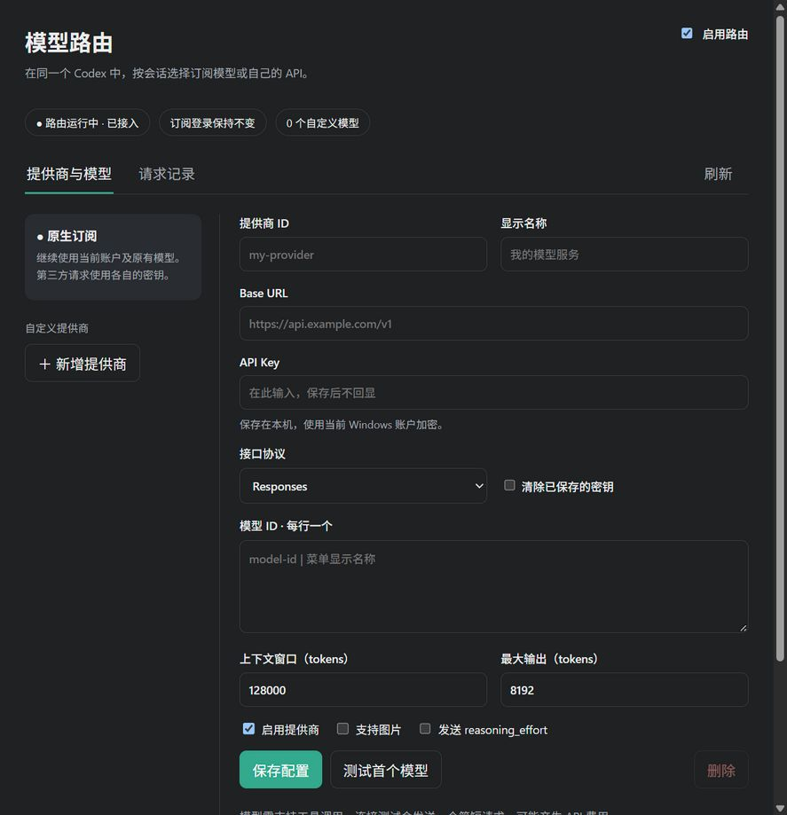

# Codex Model Router

[](https://github.com/CH3SH-LC/codex-model-router/actions/workflows/ci.yml)
[](LICENSE)

**在 Codex 应用内部管理订阅模型和自己的 API 模型。**

An in-app model router for local Codex / Work chats on Windows. Keep subscription
models and add your own Base URL, API key, and models to the native model catalog.
Settings are an MCP App inside Codex; no separate configuration app or Windows
autostart. This is an independent community project, not an official OpenAI product.

当前为 **Windows 公开预览版**。适用于桌面内的本地 Codex / Work 会话；
**不接管普通 ChatGPT 云端聊天、语音或云端任务**。第三方协议与上下文压缩兼容性有明确限制，见下文。



## 功能

- 在原生插件设置、侧栏或会话面板管理多个提供商和模型。
- 保留订阅登录与默认模型，不改客户端二进制。
- 自定义模型支持 Responses 或 Chat Completions；各会话可以分别使用不同模型。
- 支持 SSE、WebSocket 转接、工具调用、工具结果和可选图片输入。
- API Key 使用 Windows DPAPI 当前用户加密，界面保存后不回显。
- 本机请求记录仅包含提供商、模型、状态与耗时；没有遥测上传。
- 未知或禁用模型明确失败，不会自动切换提供商。
- 接入前备份配置；停用时只恢复路由写入的字段。

## 安装到 Codex

需要 Windows、**CPython 3.13 x64**，以及支持本地插件、MCP Apps 和自定义模型目录的 Codex 桌面版。
首次启用前请在 Codex 中登录并加载一次原模型菜单，让客户端建立原生模型缓存。
当前验证过的客户端和边界见 [验收说明](docs/VALIDATION.md)。

从 [Releases](https://github.com/CH3SH-LC/codex-model-router/releases) 下载源码 ZIP 并解压，
或克隆本仓库，然后在项目目录运行：

```powershell
py -3.13 scripts/install.py --check
py -3.13 scripts/install.py
```

这是一次性的插件安装脚本。它准备独立的 Python 运行环境并通过 Codex 自身接口注册插件。
安装结束后，所有日常设置和操作都在 Codex 内完成。安装不会自动启用路由，不更改登录、
默认模型、审批规则，也不会添加 Windows 自启动。

若检测不到引擎，可显式指定桌面内置引擎：

```powershell
py -3.13 scripts/install.py --codex "完整的桌面内置引擎路径\codex.exe"
```

不要使用旧版 npm CLI 代替不兼容的桌面引擎。也可以使用 `--runtime-only` 仅准备依赖，
随后在 Codex 中通过本仓库的本地 marketplace 安装插件。完整安装过程见 [安装与恢复](docs/INSTALL.md)。

## 应用内使用

1. 等当前任务结束，完整退出并重开客户端，加载插件。
2. 在 **插件 → 模型路由 → 设置** 打开面板，或在聊天中说“打开模型路由设置”。
3. 新增提供商，填写 Base URL、API Key、协议和模型 ID。密钥只填在面板中。
4. 每行一个模型，可写为 `模型ID | 菜单显示名称`。填写真实上下文窗口和能力。
5. 保存，点击“测试首个模型”。这会向该提供商发送简短请求，可能产生 API 费用。
6. 开启“启用路由”。新增或删除模型后重开客户端，在原模型菜单中选择订阅或自定义模型。

修改现有模型的地址和密钥后，下一次请求使用新配置。新模型目录需要客户端重新加载。
同一 WebSocket 连接不能跨提供商切换；客户端需重建连接，必要时新开会话。

路由仅监听 `127.0.0.1:18789`。后台网络进程由插件加载，并跟随插件租约和桌面生命周期退出；
它不是独立的常驻配置程序。

## 支持范围

| 路径 | 支持与限制 |
|---|---|
| 原生订阅 | 固定官方 Codex 上游，HTTP/SSE、WebSocket、zstd；保留原模型 ID 和订阅鉴权 |
| 自定义 Responses | 使用自己的 Key；需要上游支持 Responses SSE；压缩端点要求提供商实际支持 |
| Chat Completions | 消息、图片、函数、命名空间工具和流式适配；上游必须支持工具调用和 SSE |
| 长会话 | Chat Completions 不实现官方加密压缩协议；已有压缩历史不能转换，需新建会话 |
| 云端工具 | 官方托管搜索不会向自定义模型公布；不支持的服务端工具结果明确报错 |
| 平台 | 当前仅验证 Windows；普通 ChatGPT 云端聊天、语音与云任务不支持 |

## 数据与恢复

数据位于 `%LOCALAPPDATA%\CodexRouter`。不把该目录提交到 Git 或上传到 Issue。
路由开关只管理 `~/.codex/config.toml` 的 `openai_base_url` 和 `model_catalog_json`；
插件安装另由 Codex 维护 marketplace / plugin 条目。数据处理细节见 [PRIVACY.md](PRIVACY.md)。

卸载前，在面板关闭路由，然后重开客户端。若面板无法加载：

```powershell
& "$env:LOCALAPPDATA\CodexRouter\runtimes\1.2.0\Scripts\python.exe" main.py restore
```

恢复会保留其他配置修改；若目标字段被外部改动，会拒绝覆盖。不要通过整份旧备份覆盖新配置。

从本机试用版 `codex-router@codex-router-local` 升级时，先在旧插件中关闭路由并停用旧插件，
然后安装此版本并重新开启；不要同时启用两个同名 MCP 服务。

## 开发与贡献

```powershell
py -3.13 -m venv .venv
.\.venv\Scripts\python.exe -m pip install -r requirements.lock.txt
.\.venv\Scripts\python.exe -m unittest discover -s tests -v
py -3.13 scripts/check_public.py
py -3.13 scripts/package.py
```

见 [CONTRIBUTING.md](CONTRIBUTING.md)、[架构](docs/ARCHITECTURE.md)、[安全说明](SECURITY.md)、
[验收边界](docs/VALIDATION.md) 和 [变更记录](CHANGELOG.md)。
发行包使用明确的公开文件清单，包含逐文件 SHA-256；不包含本机配置、凭据、会话和原生模型缓存。

## 实现依据

使用已验证客户端支持的兼容插件格式 `.codex-plugin/plugin.json`。
目录注册与插件界面按 [OpenAI 插件文档](https://developers.openai.com/plugins/build/plugins)
和 [MCP Apps 扩展](https://developers.openai.com/plugins/build/extensions) 实现。
路由字段参考 [高级配置](https://learn.chatgpt.com/docs/config-file/config-advanced)
及 [订阅网关](https://learn.chatgpt.com/docs/enterprise/sign-in-with-chatgpt-through-a-gateway)。

发布到 GitHub 不代表已上架官方插件目录。项目采用 [MIT](LICENSE) 许可证。
