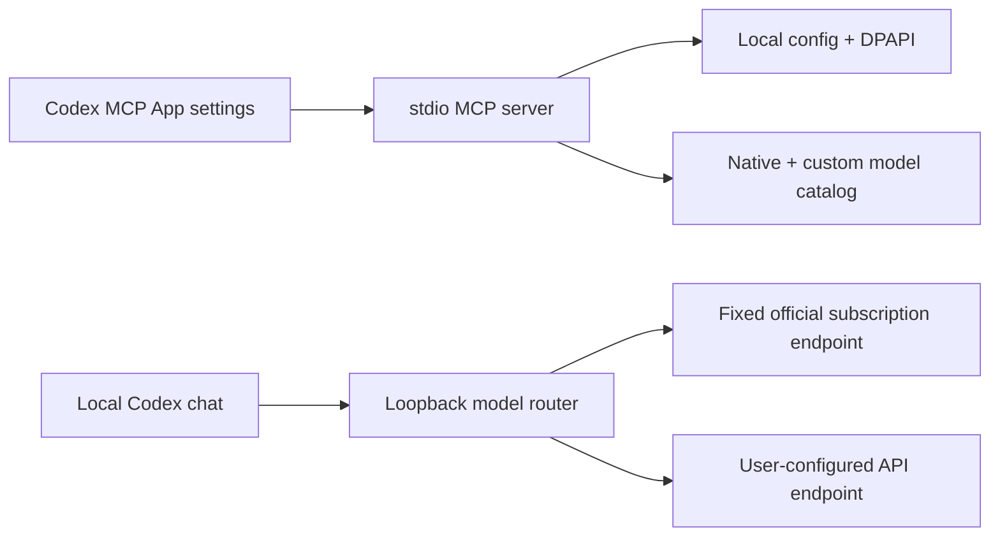

# Architecture

`mcp_app.py` owns the UI resource, app-only configuration tools, settings schema,
and backend leases. Only `open_router` is model-visible. UI mutation calls require
a per-connection session capability. The UI receives only redacted configuration.

`store.py` validates provider records, protects API keys with Windows DPAPI, and
uses revisions plus a file lock for concurrent updates. `catalog.py` merges the
native model cache with `custom/<provider>/<model>` aliases.

`integration.py` backs up and selectively modifies two TOML fields. Its receipt
allows recovery after an interrupted write and detects conflicting external edits.

`server.py` binds loopback, checks a random path capability and rejects browser
Origin requests. Subscription requests go to a fixed official endpoint. Custom
requests get the selected provider's own key; native account headers are removed.
Redirects from custom endpoints are not followed.

`protocol.py` converts supported Responses input and Chat Completions SSE,
including tool calls/results. Unsupported input fails explicitly. Native
WebSocket traffic is passed through; custom routes use HTTP upstreams and maintain
bounded per-connection history for incremental native requests.

`manager.py` launches a hidden process. `desktop_lifetime.py` observes official
Windows desktop process handles without opening or controlling UI. The backend
exits after desktop/client leases end and requests drain; the host can also clean
up its process tree.

The publisher bootstrap (`scripts/install.py`) is separate from runtime startup:
it prepares a versioned Python environment and calls Codex installation APIs.
It does not enable routing, alter authentication, or install startup tasks.
